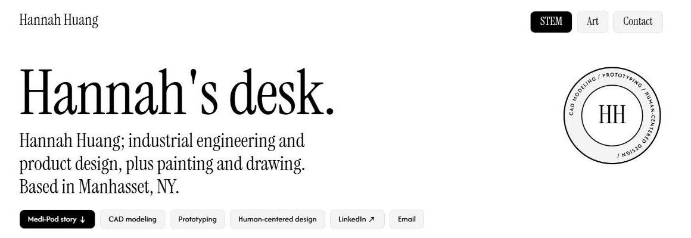
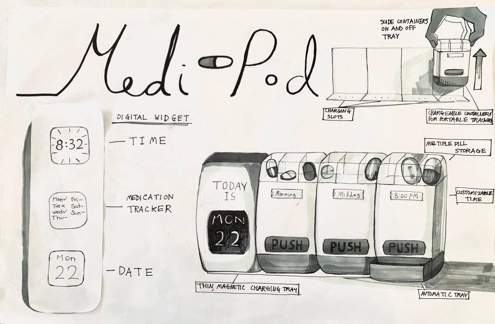
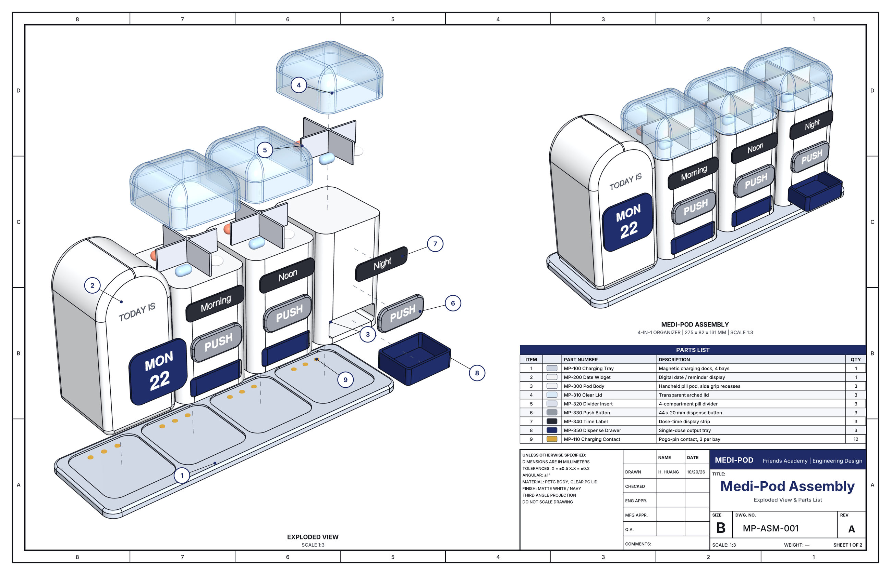
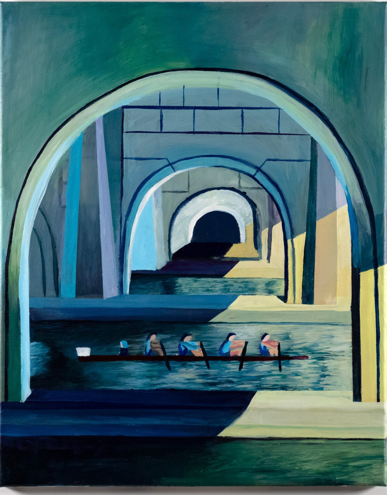

<div align="center">

# Hannah Huang · STEM & Art Portfolio

**Industrial engineering and product design, plus painting and drawing.**
Manhasset, NY

[](https://huanghannah123.github.io/STEMportfolio/)
[](https://www.linkedin.com/in/hannah-h-a89bb93b3)
[](mailto:hannahhuang0407@gmail.com)

<a href="https://huanghannah123.github.io/STEMportfolio/"></a>

</div>

---

## About

This repository holds the source of my personal portfolio, **[Hannah's desk](https://huanghannah123.github.io/STEMportfolio/)**. It collects my engineering and product design work together with my paintings and drawings. Visitors can drag pieces of work around an interactive "desk" and tap any piece to jump to its story.

**Focus areas:** CAD modeling · Prototyping · Human-centered design · Design for manufacturability

## Featured project: Medi-Pod



**A 4-in-1 medicine dispenser for elderly users with memory loss.**
Self-led pilot project, Queens, NY (September to October 2026)

- **Problem:** Older adults with memory loss often forget when to take their medication, or whether they already took it.
- **Design:** One-push Morning, Noon and Night compartments; an alarm pitched low enough to be heard through hearing aids; and an LCD screen that shows only the date.
- **Process:** I began at Georgia Tech in summer 2026, where I interviewed older adults and caregivers, built a fully 3D-modeled and animated CAD design in a two-week sprint, and gave a live demo of the working prototype to faculty and peers. I then revised the design in CAD using DFM principles.
- **Validation:** Feedback sessions with **55 elders and caregivers** at Allen Senior Home.
- **Tools:** CAD, Design for Manufacturability (DFM), 3D modeling and prototyping, user research

<br clear="right">

<p align="center">
  
  <br><sub>Engineering drawing MP-ASM-001, sheet 1: exploded view and parts list</sub>
</p>

## Art

Oil paintings and mixed media, plus drawings in pencil, ink and charcoal: design process boards, charcoal still lifes, a figure study and product sketches.

<p align="center">
  
  <br><sub><i>Stroke by Stroke</i></sub>
</p>

## Other projects

| Project | Description |
|---|---|
| [rubiks_cube_solver](https://github.com/huanghannah123/rubiks_cube_solver) | Python research project that solves the 2x2x2 Rubik's Cube optimally with BFS and IDA*, plus visual simulators |

## How the site is built

- A single self-contained `index.html` with hand-written HTML, CSS and JavaScript. It needs no frameworks and no build step.
- Hosted with **GitHub Pages** from the `main` branch.
- Interactive drag-and-drop "desk," a zoomable image viewer, and a layout that works on phones.

```text
STEMportfolio/
├── index.html                  # the whole site
├── og-image.jpg                # link preview image (Medi-Pod sketch)
├── medipod-drawing-sheet-*.jpg # Medi-Pod engineering drawings
├── stroke-by-stroke.jpg        # featured painting
├── morningsun-art/             # artwork photographs
└── docs/preview.jpg            # screenshot used in this README
```

To view the site locally, open `index.html` in any browser.

## Contact

I'm always happy to talk about engineering, product design or art.
**Email:** [hannahhuang0407@gmail.com](mailto:hannahhuang0407@gmail.com) · **LinkedIn:** [linkedin.com/in/hannah-h-a89bb93b3](https://www.linkedin.com/in/hannah-h-a89bb93b3)

---

<sub>© 2026 Hannah Huang. Site code is licensed under GPL-3.0 (see [LICENSE](LICENSE)). Artwork, photographs and drawings are © Hannah Huang, all rights reserved.</sub>
